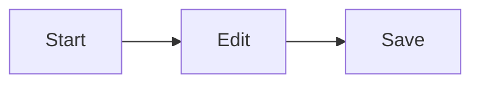

# Extended Syntax

[toc]

## Inline

A ==highlighted== word, H~2~O and X^2^, emoji :smile: :rocket: :heart_eyes:, an <u>underlined</u> phrase, red text and a key <kbd>⌘</kbd>.

Literal brackets stay as written: array[0], [x] in prose, and a footnote reference[^1].

## Callouts

> [!NOTE]
> Useful information that users should know.

> [!TIP]
> Helpful advice for doing things better.

> [!WARNING]
> Urgent info that needs immediate attention.

## Diagram

## Math

$$
\sum_{i=1}^{n} i = \frac{n(n+1)}{2}
$$

## HTML

<b>Centered HTML block</b>

[^1]: The footnote text.
